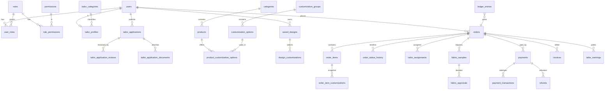

# Database Schema

PostgreSQL 16. Schema is owned by Flyway (`backend/src/main/resources/db/migration`). Conventions: `BIGSERIAL` PKs, `TIMESTAMPTZ` UTC, `NUMERIC(12,2)` money, soft delete via `deleted_at` on business entities, partial unique indexes so soft-deleted rows do not block reuse, `CHECK` constraints for enums, FK on every reference, optimistic-lock `version` on contended rows.

Legend: **[V1..V4]** = migrated now (syntax-checked, not yet run against a live DB). **[Phase n]** = planned.

## Core ER (target)

## Tables by domain

### Identity and access
| Table | Status | Notes |
|---|---|---|
| `users` | V1 | `user_type` (CUSTOMER/TAILOR/ADMIN/SUPER_ADMIN), `account_status` (PENDING_EMAIL_VERIFICATION, PENDING_PHONE_VERIFICATION, PENDING_APPROVAL, ACTIVE, REJECTED, BLOCKED, SUSPENDED, DEACTIVATED), unique `lower(email)` and phone among non-deleted, `created_by` (who created an admin), lockout fields |
| `roles` | V1 | `system_role` rows cannot be deleted |
| `permissions` | V1 | `code` like `product:manage`, grouped by `module` |
| `role_permissions`, `user_roles` | V1 | `user_roles.assigned_by/at` for history |
| `user_permission_overrides` | V1 | per-user grant/deny layered over roles (not in original list; needed for "enable/disable individual permissions") |
| `user_verifications` | V1 | email link / phone OTP, only hashes stored, attempts counter, expiry |
| `refresh_tokens` | V1 | hashed token, `family_id` for rotation and reuse detection |
| `login_logs` | V1 | success/failure, IP, UA |

### Audit, notifications, settings
| `audit_logs` | V2 | before/after JSONB, actor, entity |
| `activity_logs` | V2 | user-facing/admin activity feed |
| `notifications` | V2 | in-app; partial index on unread |
| `website_settings` | V2 | JSONB key/value; `is_public` controls storefront exposure |
| `security_logs`, `api_error_logs` | Phase 13 | |

### Tailors
| `tailor_categories` | V3 | admin-configurable, `stitching_price`, soft delete |
| `tailor_profiles` | V3 | category, skills, availability, rating aggregates |
| `tailor_applications` | V3 | statuses per spec 22B; partial unique index allows one open application per applicant |
| `tailor_application_documents` | V3 | storage keys for portfolio and ID |
| `tailor_application_reviews` | V3 | append-only approval history (reviewer, decision, reason, note) |
| `tailor_availability` | Phase 7 | schedules / capacity |

### Catalog and customization (Phase 4)
`categories` (tree: Men/Women/Kids, garment types), `products`, `product_images`, `product_variants` (sizes), `fabrics`, `colors`, `customization_groups`, `customization_options` (price delta, `render_binding` JSON, dependency rules), `product_customization_options` (which options each product offers), `garment_models` (3D asset per product), `collections` + `collection_items` (trending/featured, with `source` column for future external trend providers).

### Customer data (Phase 5)
`addresses`, `measurement_profiles`, `measurements` (named values per profile), `saved_designs`, `design_customizations`.

### Commerce (Phase 8-11)
`carts`, `cart_items` (+ customization snapshot), `coupons`, `orders` (order_number, totals breakdown, `tailor_id`, `tailor_category_id`, status, `version`), `order_items`, `order_item_customizations` (immutable snapshot), `order_status_history`, `tailor_assignments` (partial unique `(order_id) WHERE active`), `fabric_samples` (revision number, photos), `fabric_approvals` (decision, actor, timestamp), `delivery_tracking`, `reviews`.

### Payments and finance (Phase 8, 12)
`payments` (internal id, customer, order, razorpay_order_id, razorpay_payment_id UNIQUE, amount, currency, method, status, failure_reason, gateway ref), `payment_transactions` (each attempt/event), `payment_webhook_events` (UNIQUE `event_id` for idempotency, raw payload, processed_at), `refunds`, `invoices`, `commissions` (rules), `tailor_earnings`, `settlements`, `ledger_entries` (append-only, not in original list; auditable separation of customer money / tailor earnings / platform revenue).

## Seed data (V4)
Roles: SUPER_ADMIN, ADMIN, CUSTOMER, TAILOR. 28 permission codes. Super Admin gets all; ADMIN starts empty by design. Five sample tailor categories at price 0.00 (placeholders for admin to set). Default theme tokens and site identity. **No user accounts are seeded**; the Super Admin is created at first start from env vars (Phase 2).
