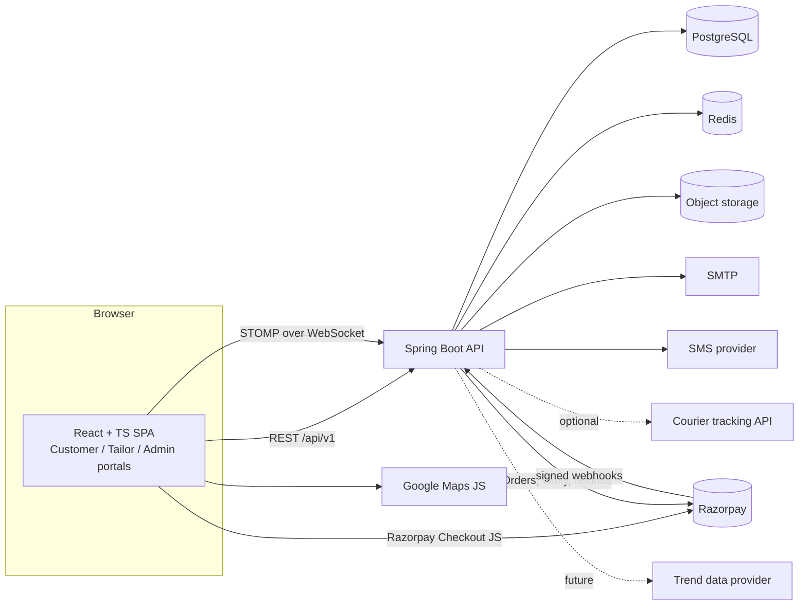

# Project Architecture

Brand placeholder: **Stitchline** (rename via `site.identity` setting and `index.html`).

## 1. Decision summary

| Decision | Choice | Why |
|---|---|---|
| Style | **Modular monolith** (single Spring Boot app, strict module boundaries) | One deployable, transactional integrity for orders/payments/assignment, easy to split later. Microservices would add distributed-transaction risk with no benefit at this scale. |
| API | REST, JSON, `/api/v1`, uniform envelope | Matches spec; versioned from day one. |
| Auth | Stateless JWT access token (15 min) + rotating refresh token (hashed in DB, family reuse detection) | Spec section 16. |
| Authorization | RBAC with permission codes (`module:action`) + per-user overrides, enforced by `@PreAuthorize` and service checks | Spec sections 3, 22. Frontend hiding is cosmetic only. |
| Realtime | Spring WebSocket + STOMP; per-user queues (`/user/queue/notifications`), role topics (`/topic/tailors/{categoryId}/orders`). Redis pub/sub relay when running more than one instance | Real-time tailor alerts and order tracking. |
| Database | PostgreSQL 16, Flyway migrations, Hibernate `ddl-auto=validate` | Schema owned by migrations only. |
| Cache/OTP | Redis (OTP attempt counters, rate limiting, hot reads such as public settings/catalog) | Spec section 2. |
| Files | `StorageService` interface; S3-compatible implementation. DB stores object keys, never public URLs. Served via short-lived signed URLs | Secure uploads for portfolios, IDs, fabric samples. |
| 3D | React Three Fiber + glTF models with named mesh groups; options map to material/mesh toggles. 2D layered SVG/PNG fallback | See section 6. |

## 2. System context



## 3. Backend layering

Per module under `com.clothingplatform.<module>`:

```
controller/   HTTP only: validation (@Valid), DTO in/out, no business logic
service/      business rules, transactions, authorization checks, audit calls
repository/   Spring Data JPA, custom queries (locking, atomic updates)
entity/       JPA entities (never returned from controllers)
dto/          request/response records
mapper/       entity <-> DTO
validator/    cross-field and domain validators
```

Cross-cutting: `config` (typed properties, OpenAPI), `security` (filter chain, JWT, permission evaluator), `audit` (audit/activity writers), `common` (envelope, base entity), `exception` (typed errors + `GlobalExceptionHandler`).

Module boundary rule: a module calls another only through that module's **service interface**, never its repository or entities. Domain events (`ApplicationEventPublisher`) decouple side effects (notifications, audit, ledger posting) from the core transaction.

### Provider abstractions (ports)

`PaymentGateway` (Razorpay impl), `SmsSender`, `EmailSender`, `StorageService`, `CourierTracker` (admin-managed impl first), `TrendProvider` (admin-curated impl first), `GeocodingService`. Each has one configured implementation selected by properties, so tests use fakes and vendors can change.

## 4. Security design

- BCrypt (cost 12). Account state checked on every login and every token refresh: `ACTIVE` only.
- **Tailor login gate (spec 22B)**: `UserDetails` exposes `account_status`; `AuthenticationService` maps `PENDING_APPROVAL`, `REJECTED`, `BLOCKED`, `SUSPENDED` to distinct error codes (`TAILOR_PENDING_APPROVAL`, ...) carrying the exact messages from the spec. The JWT filter re-checks status per request (cached briefly in Redis, evicted on status change), so a blocked user loses access immediately, not at token expiry.
- Ownership checks live in services (`order.tailor_id == currentUser`), not just URL patterns. Tailors can never read other tailors' orders.
- Admin creation requires `admin:create`. Granted only to SUPER_ADMIN by seed; the Super Admin may grant it explicitly.
- Rate limiting (Redis token bucket) on login, OTP, password reset, webhook-adjacent endpoints.
- Uploads: size cap, content-type sniffing (not only extension), image re-encode, randomized keys, private bucket.
- Audit: every admin, approval, payment and financial mutation writes `audit_logs` (actor, before/after JSON, IP) in the same transaction.
- Secrets only from environment variables. `.env` is git-ignored.

## 5. Critical flows

### 5.1 Concurrency-safe tailor assignment (spec section 7)

Do not read-then-write. Accept is a single conditional update:

```sql
UPDATE orders
   SET tailor_id = :tailorId, status = 'TAILOR_ASSIGNED', version = version + 1
 WHERE id = :orderId AND tailor_id IS NULL AND status = 'TAILOR_ASSIGNMENT_PENDING';
-- rowsAffected == 1 -> this tailor won; 0 -> "already taken" (409)
```

Backed by a partial unique index on `tailor_assignments(order_id) WHERE active`, plus the tailor-category eligibility check inside the same transaction. The winner's transaction inserts the assignment row and status history; an `OrderAssigned` event then pushes "remove from list" to other tailors and notifies customer and winner. A load test (50 parallel accepts, exactly 1 success) is part of Phase 9 exit criteria.

### 5.2 Razorpay payment (spec section 23)

1. `POST /payments/razorpay/orders` : server recomputes total from DB prices (ignores any client amount), creates the Razorpay Order (amount in paise), saves `payments` row `PENDING`, returns `orderId` + public key id.
2. Frontend opens Checkout; on success posts `razorpay_order_id`, `razorpay_payment_id`, `razorpay_signature` to `POST /payments/razorpay/verify`.
3. Server verifies `HMAC_SHA256(order_id|payment_id, key_secret)` with constant-time compare, then fetches the payment from Razorpay to confirm status and amount. Only then `SUCCESS`, order `PAYMENT_CONFIRMED`, assignment starts, invoice created.
4. Webhook `POST /payments/razorpay/webhook`: verify `X-Razorpay-Signature` over the **raw body** with the webhook secret; dedupe on `X-Razorpay-Event-Id` (unique constraint in `payment_webhook_events`); process idempotently in one transaction. Webhook is the safety net when the browser never returns.
5. A scheduled reconciliation job re-checks `PENDING` payments older than N minutes.

COD: `payments.method = COD`, `status = PENDING_COLLECTION`; order proceeds to assignment; an authorized admin marks collected after delivery.

### 5.3 Order state machine

`OrderStatus` enum + an explicit transition table (`from -> allowed to, allowed actor roles`). Every change goes through `OrderStateService.transition(...)`, which validates, writes `order_status_history` (status, time, actor, description, attachments) and publishes an event. The fabric gate is a transition rule: `FABRIC_APPROVED` is required before `CUTTING_IN_PROGRESS`.

### 5.4 Money

All amounts `NUMERIC(12,2)` in INR (paise integers only at the Razorpay boundary). Customer payments, tailor earnings and platform revenue are kept separate through an **append-only `ledger_entries`** table (double-entry style: debit/credit accounts such as `CUSTOMER_RECEIVABLE`, `GATEWAY_CLEARING`, `TAILOR_PAYABLE`, `PLATFORM_REVENUE`, `REFUNDS`). Reports read the ledger; entries are never updated, only reversed.

## 6. 3D customization engine

**Data model**: `garment_models` (glTF asset key, default camera, scale) per product; `customization_options` carry a `render_binding` JSON, for example `{"type":"MESH_TOGGLE","group":"collar","mesh":"collar_mandarin"}`, `{"type":"MATERIAL_COLOR","slot":"body"}`, `{"type":"TEXTURE","slot":"body"}`, or `{"type":"MORPH","target":"fit_slim"}`. The frontend never hardcodes options: it renders whatever the product's option groups say and applies each binding to the model.

**Renderer**: `<GarmentViewer>` (R3F) with OrbitControls (rotate 360, zoom), preset camera views (front/back/side), PBR fabric textures from the fabric catalog. If a product has no `garment_models` row or WebGL fails, `<Garment2DPreview>` composites layered images per selected option (same `render_binding` format, layer type).

**Reality check**: the code can be built in Phase 6, but the *quality* depends on art assets (see section 8). Without modelled garments with correctly named meshes, only placeholder geometry can be shown.

**Persistence**: `saved_designs` + `design_customizations` (one row per selected option, value validated against the product's allowed options on the server). The same structure is copied into `order_item_customizations` at checkout as an immutable snapshot, so later admin edits never change an ordered garment.

## 7. Frontend architecture

```
frontend/src
  components/ui      Button, Input, Skeleton, EmptyState, ErrorState, Toaster, ConfirmDialog
  layouts            PublicLayout, DashboardLayout (tailor/admin), PageTransition
  pages              page components per portal (stubs until their phase)
  routes             route table; ProtectedRoute (Phase 2)
  store              zustand: auth, toast (cart/customizer later)
  lib                axios client, error mapping
  theme              CSS-variable tokens + ThemeProvider (admin-editable at runtime)
  features/          (from Phase 2) feature folders: api hooks, forms (react-hook-form + zod), components
```

Colors are CSS variables (`rgb(var(--primary) / <alpha>)`) wired through Tailwind, so Super Admin theme edits apply without rebuilding. `prefers-reduced-motion` is respected globally.

## 8. External services and assets required

| Need | Who provides | Needed by |
|---|---|---|
| Razorpay account, test key id/secret, webhook secret | You | Phase 8 |
| SMTP credentials (e.g. any transactional email provider) | You | Phase 2 |
| SMS/OTP provider account (India DLT registration required for commercial SMS) | You | Phase 2 |
| Object storage bucket + keys (S3-compatible) | You | Phase 2 (tailor uploads) |
| Google Maps API key (Places/Geocoding/JS) with domain restrictions | You | Phase 8 |
| **3D garment models (glTF/GLB)** with named meshes per customizable part, plus fabric textures | A 3D artist or licensed asset packs. Cannot be generated by code | Phase 6 |
| Courier API credentials (optional) | You | Phase 11 |
| Fashion trend data provider (optional) | You | Future |

## 9. Hardest problems and mitigation

1. **3D customization fidelity**: asset-dependent, GPU/mobile performance. Mitigation: glTF with Draco compression, lazy-loaded canvas, texture size caps, 2D fallback, build the pipeline against 2 garments (shirt, trousers) first.
2. **Concurrent assignment**: solved with conditional update + unique index; tested under parallel load.
3. **Payment correctness**: server-side pricing, signature + status verification, webhook idempotency, reconciliation job.
4. **Fully dynamic customization + pricing**: option price deltas, dependencies (e.g. cuff style only for long sleeves) and validation must be data-driven. Mitigation: option rules table, server-side validation of every saved configuration.
5. **Fine-grained RBAC consistency**: one permission catalogue, single evaluator, contract tests asserting every admin endpoint rejects a user lacking its permission.
6. **Scope**: 14 phases; each phase must stay runnable and tested before the next starts.
